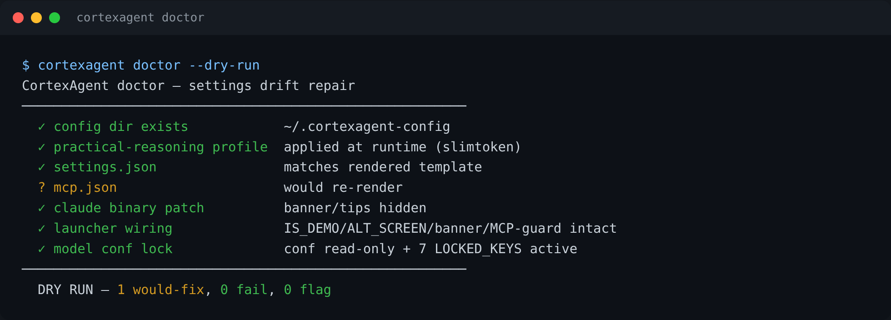

<div align="center">
  
</div>

# CortexAgent

**CortexAgent** is a multi-agent execution environment that runs on your own GPU. It orchestrates complex, multi-step workflows — planning, tool calls, subagents, and DAG pipelines — against local open-weight models, with token compression and persistent memory layered in front of the model so long sessions fit in one VRAM budget. It is a hard fork of pi.dev, reshaped for fully-local, single-machine use.

Local models are the default, not a fallback: the agent boots a llama.cpp server you own, records memory to a file on your disk, and keeps logs on your machine. External model lanes exist but are strictly opt-in — an endpoint is only called if you register it yourself. There are no built-in tool bundles, no daemon mesh, no dashboards, and no telemetry.

<div align="center">
  
</div>

## Features

**Local GPU priority.** The launcher starts a llama.cpp server bound to `127.0.0.1`, with flash attention on and a quantized KV cache, and negotiates the largest context that fits your VRAM. Compression (`lib/prompt_reframe.py`) rewrites history and tool output to the configured token budget before each model call — this is what lets a 35B-class model carry long working sessions on one GPU. If the model file is missing the launcher says so and stops; it never silently falls back to a cloud model.

**Tool orchestration.** The loop gets a goal and returns either an answer or one tool call; the harness executes it and feeds the result back, under a step cap and a loop guard. Nine built-in tools cover the core actions — `run_command`, `web_search`, `download`, `parse_document`, `rag_query`, `query_llm`, `spawn_subagent`, `coding_practices`, and `add_llm_provider` — plus two bundled MCP servers: **Chrome control** (navigate, click, type, fill-and-send, fetch page text, evaluate JavaScript, accessibility snapshots in a real browser) and a **Firecrawl proxy** for scraping beyond a plain download. Anything else arrives as an MCP server you installed on purpose; servers wake lazily only when one of their tools is called.

**Extensible workflows.** Single-agent tasks run in the ReAct-style loop; larger jobs decompose into a DAG of tasks with dependencies and priority (`engine/dag.py`, `engine/workflow.py`), batched per engine. Helper agents run on subtasks via `spawn_subagent`, with an overseer keeping the fan-out in check.

**Ecosystem integration.** CortexAgent plugs into the rest of the greyok toolchain, all of it local-first:

- **SlimToken** — a standalone token-optimization and memory proxy (Anthropic/OpenAI/Ollama-compatible). Putting the agent's model lane behind SlimToken adds request minification, deduplication, and distillation, with a recallable memory layer; nothing dropped is unrecoverable.
- **GreySearch** — a local-first web research tool. Point `~/.cortexagent/mcp.json` at GreySearch's MCP server and the agent gains autonomous research passes (search → headless-browser rendering → filtering → synthesized, citable guides).

Neither is required; both are added on purpose, from their own repos.

## Setup

Requirements: Linux, Python 3.12+, a llama.cpp build with an OpenAI-compatible server, and a local GGUF model. The default model is **Qwen3.6-35B-A3B** (Q4_K_M GGUF) at `~/models/Qwen3.6-35B-A3B-Q4_K_M.gguf`.

Install from the release wheel (the wheel carries the compiled core and the `cortexagent` command):

```bash
pip install https://github.com/greyok00/cortexagent/releases/latest/download/cortexagent-0.8.0-cp313-cp313-manylinux_2_41_x86_64.whl
```

Or clone and install with the systemd units, hooks, and config templates:

```bash
git clone https://github.com/greyok00/cortexagent
cd cortexagent
./install.sh
```

`install.sh` is re-runnable and non-destructive: it renders config templates, installs the systemd user units, and wires the hooks. The wheel installs code but not units — clone for the full daemon setup.

Then run it:

```bash
cortexagent daemon start   # boot the persistent backend (model + memory + control socket)
cortexagent                # start an interactive session
```

First run auto-negotiates the context from your VRAM; if the model path is wrong it prints the expected location and exits. `cortexagent doctor --dry-run` checks the installation against the current version at any time.

### Configuration

Everything is driven by environment variables or the config file `~/.cortexagent/cortexagent.conf`; the agent makes no external requests on its own. The variables most commonly changed:

| Variable | Default | What it controls |
|---|---|---|
| `CORTEXAGENT_MODEL` | `~/models/Qwen3.6-35B-A3B-Q4_K_M.gguf` | Local GGUF model file for llama.cpp |
| `CORTEXAGENT_LLAMA_DIR` | `~/llama.cpp/build` | Where the llama.cpp server binary lives |
| `CORTEXAGENT_LOCAL_PORT` | `11599` | Port the local model server binds on 127.0.0.1 |
| `CORTEXAGENT_CTX` | Auto-negotiated down from 131072 | Context window attempted |
| `CORTEXAGENT_MCP_CONFIG` | `~/.cortexagent/mcp.json` | Which MCP servers are attached |
| `CORTEXAGENT_ROUTER_MODE` | `auto` | Local-versus-cloud model routing mode |
| `CORTEXAGENT_STATE_DIR` | `~/.cortexagent` | Where daemon state, workflow state, and memory live |
| `CORTEXAGENT_BROWSER_MCP_ENABLED` / `CORTEXAGENT_FIRECRAWL_ENABLED` | `on` / `1` | Toggles for the two bundled integrations |

Tuning knobs for the model server itself (`CORTEXAGENT_NGL`, `CORTEXAGENT_FA`, `CORTEXAGENT_CTK`/`CORTEXAGENT_CTV`, `CORTEXAGENT_TEMP`, `CORTEXAGENT_TOP_P`, `CORTEXAGENT_TOP_K`, and friends) all have working defaults and are only needed for specific hardware. `cortexagent doctor --dry-run` reports and repairs configuration drift without writing anything until you drop the flag.

## Usage

Run `cortexagent` with no arguments for an interactive session, or use subcommands:

```bash
cortexagent run [args]                 # run the agent (default verb)
cortexagent daemon {start|stop|status|run}   # lifecycle of the persistent backend
cortexagent status                     # one-shot daemon + session status
cortexagent queue {list|clear|done|drop|context} [item_id]   # manage the prompt queue
cortexagent doctor [--dry-run] [--json]  # detect/repair settings drift
cortexagent install [args]             # OS-aware install (systemd service)
```

The daemon holds the model and the memory; status shows the active lanes (the SlimToken proxy ports and the local Ollama-compatible endpoint), active sessions, and idle time. The queue feeds prompts to the daemon for unattended processing — list items, mark them `done`, `drop` them, or inspect their recorded `context`.

**Example: a document pipeline.** Tell the agent: *Download https://example.com/report.pdf, summarize it, and save the summary to notes/.* It runs `download` → `parse_document` → writes the summary itself → `run_command` to save the file, with memory recording the task and the status line showing loop step and compression savings.

**Example: browser work.** *Open the internal wiki, log in, find last sprint's release notes, and paste them into the standup doc.* It navigates, fills the form, reads the page, and writes the doc — in the visible browser window, using the session you already trust.

**Example: a multi-step workflow.** A bigger goal decomposition — "gather competitor pricing from three sites, cross-check the CSVs, and draft a comparison" — expands into a task DAG; independent tasks batch in parallel under the scheduler, `spawn_subagent` handles the leaf work, and `cortexagent status`/`queue` track it from outside.

**Example: ecosystem lanes.** Attach GreySearch by adding its MCP server to `~/.cortexagent/mcp.json`, then ask: *Run a research pass on X and turn the result into a local guide.* Put the model lane behind SlimToken and the same session keeps working memory past the context window: compressed requests in, and every dropped byte recallable on demand.

## How it works

**The loop** (`engine/`) is a ReAct-style cycle: the model gets a goal, produces either an answer or one tool call, and the harness executes that call and feeds the result back. The step cap and loop guard are the entire self-control story; there is no planner stack or reflective meta-loop.

**Compression** (`lib/prompt_reframe.py`) rewrites the context before each model call. Conversation history and tool output are shortened to fit the configured token budget, and prompts are cleaned up in a fixed, repeatable way: filler words and hedges are removed, repeated sentences are dropped, and a short system hint appropriate to the task domain is added.

**Memory** (`memory/`) stores session data in one NJSON file at `~/.config/cortexagent/memory/cortexagent.jsonl`. A cold distillation pass moves long-lived facts into a separate cold file and drops the rest. You can read the file with any text tool, back it up, or delete it at any time; there is no database or background service behind it. The knowledge index (`lib/domain_db.py`) reads from a local SQLite side-database, so retrieval works without any service running.

**Control** (`lib/control.py` plus systemd user units) is one Unix control socket. systemd owns the lifecycle of the daemon (`Type=simple`, restart on failure); the socket answers presence, status, and stop queries; `bin/cortexagent` is the launcher; and `lib/doctor.py` repairs configuration drift non-destructively (`cortexagent doctor --dry-run` first, always).

**The MCP client** (`lib/mcp_client.py`, `lib/lazy_mcp_proxy.py`) is client-only: the repo registers zero MCP servers. You point `~/.cortexagent/mcp.json` at servers from their own repos, and a lazy-start proxy only wakes one when a tool it owns is actually called.

## The tree, explained

| Directory | Contents | Shipped as |
|---|---|---|
| `bin/` | Launcher (`cortexagent`), browser health check, verify gate | Shell (readable) |
| `engine/` | The agent loop, DAG workflows, CLI entry | Compiled |
| `lib/` | Compression, memory, control socket, doctor, MCP client, browser guard | Compiled |
| `memory/` | NJSON memory manager, cold distiller, knowledge index | Compiled |
| `tools/` | Manifest builder, contract test, smoke layers | Compiled |
| `scripts/` | `pdeathspawn.py` (parent-death-bound launcher), `warm_model.py` | Readable |
| `tests/` | `run_smoke.py` plus fixtures | Readable |
| `config/` | MCP and settings templates, systemd units | Readable |

Most of the Python under `engine/`, `lib/`, `memory/`, and `tools/` ships as native-compiled modules, with a small set of readable entry-point files that shell scripts and systemd units invoke directly by path; tests, hooks, and config templates stay readable so the harness can be verified without a build step.

## Verify

```bash
python3 tests/run_smoke.py
```

The smoke suite builds its test list from the live handlers, so nothing checked is hand-written: it imports every shipped module (compiled or not), verifies systemd unit hygiene, greps the tree for personal paths, and exercises the loop and memory against an isolated test directory.

## License

Licensed under the Apache License 2.0. See [LICENSE](LICENSE).