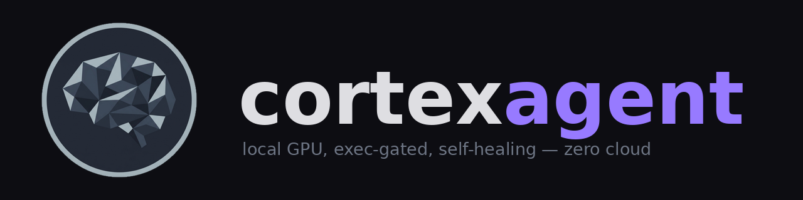

<p align="center"></p>


# cortex-agent

A hardened agent harness that runs on your own GPU and never gets in anything else's way. One renamed engine binary, one private port family, one bash policy — so it never touches, matches, or takes over another stack on the machine. Built as the rewrite of the cortexagent family: everything it needs ships in-box, and it runs wherever you run it — a laptop with no accounts, an offline box, or behind your own ollama.

Three big ideas set it apart from generic harnesses:

1. **VRAM-fitted model cards.** Preconfigured picks per GPU size — reasoning-first, fully in VRAM, measured.
2. **Research, RAG knowledge, memory, and the exec gate ship in-box and always attach.** Those lanes spawn from sha256-pinned vendored sources at every start — a session never discovers mid-task that its research or knowledge lane failed to attach, and nothing outside the repo can alter what the lanes run.
3. **Structural coexistence.** Names and ports are the isolation: `cortex-agent` is a uniquely named engine copy; :7100/:7101 are private. A normal `llama-server`, ollama, or any other tool is never matched, routed through, or interrupted.

---

## The three GPU cards (the separation)

Each card size is its own preconfigured profile — a different stock (non-abliterated) MoE per card, fully resident in VRAM (no CPU offload, no silent spill), ubatch 2048, n-gram speculative decoding pinned on all three, reasoning chosen first and token speed second.

| Card | Profile | Model (stock, stock quant) | Context | KV | Measured on reference HW |
|---|---|---|---|---|---|
| 16 GB | `vram16` | Qwen3.6-35B-A3B UD-IQ3_XXS | 131k | q8_0 | 14,971 MiB · boot 18 s · 59→84 t/s |
| 8 GB | `vram8` | Ling-3.0-tiny Q6_K | 64k | q8_0 | 7,229 MiB · boot 8 s · ~114 t/s |
| 4 GB | `vram4` | LFM2.5-8B-A1B UD-IQ2_M | 32k | q8_0 | 3,555 MiB · boot 6 s · 130–181 t/s |

How the separation behaves:

- The launcher reads installed VRAM once and picks the card automatically (`CORTEXENGINE_PROFILE` overrides).
- Inside a card, the context ladder steps down in 8192-token increments if the card refuses (other apps holding VRAM).
- If the whole card profile refuses, the launcher **steps down to the next smaller card and announces it** — never a silent model change.
- Cards are user-editable in `agent-home/model-cards.json`: list **your own** model as the 4/8/16 pick, keep `max_gb` so the picker knows which card it fits, and add `url`/`bytes` to enable the printed fetch command (aria2c with byte verification).
- The 4 GB card is honest about itself: at 32k it's a probe card, not a workhorse — relax context further and better files open up.

## Inference spec

- **Speculative decoding:** n-gram-mod (`n-match 24`, `n-min 48`, `n-max 64`) — a ~16 MB observed-n-gram table in RAM, no drafter model, no VRAM cost. Drafts only when a long n-gram match exists, so reasoning/short answers pay nothing while long copy/code output gains ~27% warm throughput (measured: 79.1 plain → 100.7 t/s warm-table on the 35B card; 0 MiB VRAM delta).
- **Sampling:** temperature 0.4 (owner-tuned stability), top_p 0.95, top_k 20 — clamped in code on every request by the sampling guard, so a misbehaving model or provider can't drift the profile.
- **KV cache:** q8_0 on the 16/8 GB cards, q4_0 on 4 GB where the window budget demands — quantized attention state bought the 64k–131k windows that float KV wouldn't fit.
- **Boot ladder:** every profile descends context in 8192-token steps (131072 → 8192 floor) until the card accepts — a busy machine gets a smaller window with the same brain, then a smaller card if the card itself refuses (announced at boot).

## How it is hardened

| Layer | Mechanism |
|---|---|
| Engine identity | llama.cpp copy renamed `cortex-server`, `$ORIGIN`-patched libs inside `vendor/engine/` — a foreign kill sweep can never name-match a normal `llama-server` |
| Boot gate | frozen-tree verification: 1,900+ files sha256-pinned; desynced dist or tampered artifact → boot refused loudly |
| Bash policy | exec gate with ~55-token allowlist, confined redirects, teaching refusals — one policy enforced in both the core lane and the TUI lane |
| Session health | supervision plane: watcher → healer → steer channel, epoch-safe, lessons ledger; catches refusal storms, streaks, and 1-token storms live |
| Lane integrity | greysearch + knowledge + memory spawn from vendored sources, per-file sha256 pins, spawn retries, respawn on demand — a pin mismatch yields a loud refusing probe, never silence |
| Loop defense | streak guards + teachable refusals + steer cooldowns; the harness learns the sanctioned route instead of repeating a refusal |
| Coexistence | ports 7100/7101 are private; foreign holders are refused, never fought; cleanup reaps only captured PIDs |
| Data boundaries | inference stays on the machine you point it at; isolated browser profile; per-session memory; no prompt file is required for any behavior |

## Built-in lanes (converted from MCP servers, and why)

greysearch (research), knowledge (RAG), and memory used to be MCP servers with a toggle registry. They were converted into baked-in lanes on purpose:

- **Stability:** the registry was the failure point — lanes were enabled in config but silently failed to attach (a hand-edited registry, a startup race, the per-session spawn racing the model load), and a session that lost its research lane lost the feature without anything reporting why.
- **Pinned sources:** each lane spawns from sources vendored inside this repo, verified against a sha256 pin at every start — a swapped or edited file produces a loud refusing probe instead of a silently altered tool.
- **Always attached:** lanes spawn at every TUI start with retries and respawn-on-demand; the executor re-launches a dead lane with the same tool surface, so a lane can't be lost by toggling it off.
- **Tool identity preserved:** tool names keep the historical mcp_* prefix for skill compatibility.

| Lane | Tools | What it gives the session |
|---|---|---|
| greysearch | greysearch, greysearch_health | multi-source deep runs with lane-truth reporting, background jobs with digests |
| knowledge | kb_status/search/get/ingest (urls, pdf, text), learn (topic/status), rebuild, delete, jobs | per-database RAG packs, firm/soft bands, self-filling topic loop |
| memory | memory_read/write/search/stats/clear | hot/cold fact tiers, restart-persistent |

## Skills (the full set)

**Workflow:** brainstorming · writing-plans · executing-plans · subagent-driven-development · dispatching-parallel-agents · test-driven-development · systematic-debugging · verification-before-completion · requesting-code-review · receiving-code-review · finishing-a-development-branch · using-git-worktrees · using-superpowers · writing-skills

**Extras:** diagnosing-superpowers · greysearch-research · knowledge-rag · memory-tiers · research-lane

Plus `pi-subagents` bundled (council, parallel-research/review/cleanup, review-loop, gather-context — all offline-vendored).

## Why it's different

| Common harness | cortex-agent |
|---|---|
| MCP registries that can be toggled off (and drift off) | lanes vendored, hash-pinned, always spawned — loud probe on tamper |
| Cloud-first or BYO-everything config | three measured GPU cards; zero-config pick for your hardware |
| One shared model server for everything | uniquely named engine + private ports; structural non-interference by law |
| Prompt files that carry critical behavior | ALL enforcement lives in code; prompt files are optional documentation |
| Output styling left to the model's mood | beautify enforced per-turn in code: purple keywords, auto-boxed emoji-safe tables, chart/spark fences |
| Sibling projects patched ad hoc | fork-not-patch law: fixes happen in forks, upstream untouched |

## Cloud and ollama — use it with standard ollama safely

The harness → internal proxy → standard ollama, one command, nothing modified:

    cortex-agent ollama

Chain: **TUI → slimtoken lane on private port :7112 → your ollama** (default `http://127.0.0.1:11434`, override with `CORTEXENGINE_OLLAMA_URL`; model via `CORTEXENGINE_OLLAMA_MODEL`).

- Your ollama is untouched: we spawn our own slimtoken on our own port, forwards only, and stop **our** lane on exit — we never stop or reconfigure yours.
- The no-interceptor law is preserved: pointing the passthrough at the cloud-direct lane (:11600) is refused — that lane exists for direct calls only. Point it at your standard local ollama endpoint instead.
- The brain still gets the same privacy posture: no external AI providers, slimtoken as a client-side filter only.
- Cloud models, if you ever want them, ride the same pattern with `CORTEXENGINE_OLLAMA_URL` pointed at any OpenAI-compatible cloud endpoint — the agent still never speaks to a provider directly; it always goes through the lane.

## Ports

| Port | Owner |
|---|---|
| 7100 / 7101 | cortex-agent engine + lane |
| 7112 | ollama passthrough lane (transient, own process) |
| 8888 | shared local SearXNG |
| 8792 | cortex-agent library UI |
| 8791 / 11600 / 11434 / 1143x / 1159x | other stacks — never touched |

## Self-healing and step-down

The harness fixes its own problems in layers, from instant-reflex to learned behavior:

**Session step-down (models).** If a card's model can't fit at boot — other apps holding VRAM, a ladder that bottoms out — the launcher automatically brings up the next smaller card's profile and says so in the boot line (`vram16 refused, running vram8`). Within a card, the context ladder descends in 8192-token steps first, so a busy machine usually just gets a smaller window with the same brain. Model identity is always announced, never silently changed.

**Per-turn self-healing (refusals and loops).** When the exec gate refuses a command, the refusal text itself teaches the sanctioned route (absolute paths are fine, `bash script.sh` with a redirect tail, nothing else) — and supervision tracks refusal age: while refusals are less than 15 minutes old, a single cooldown-gated steer is injected into the live session that names the working route. Repeating the same refused call or looping identical tool calls is detected by the session watcher (identical-call streaks, `length`-stop storms) and surfaced as a steer before the session burns its budget. Every learned diagnosis persists in a lessons ledger — repeat sightings escalate to the right action immediately instead of starting from zero.

**Machine self-healing (lanes and server).** The model server and lane have systemd-level watchers that reboot them on death; the heal loop only escalates to manual restarts after several consecutive misses. Lanes (greysearch/knowledge/memory) respawn on demand inside a session if their process dies, after re-verifying their pins — a dead lane can never go silently missing.

## Stepping down across cards

Boot refusal ladder, in order:
1. Context ladder: 131k → 123k → ... (8192 steps) until the card accepts.
2. VRAM gate: estimate-vs-free check refuses before loading if even the minimum won't fit.
3. Card step-down: launcher re-picks the next smaller profile and re-runs the same ladder.
Each transition is announced in the boot line; the session then runs with the smaller card as if it had booted that way.

## Output modes

cortex-agent's output is beautified by default: pipe tables render as aligned box tables with purple headers, keywords and skill names color laser-purple, numeric answers draw as chart/spark bars, and status markers (✅ ❌ 🔄 ⚠️) ride the data.

Say **plain** when you need copy-pasteable text instead: the same reply is resent as a plain full-width block with no tables, markers, or color — built for docs, tickets, and emails.

## Output modes: beautified (default) and plain

cortex-agent's output is beautified by default — the renderer turns every pipe table into an aligned box table with purple headers, colors keywords and skills in laser purple, and draws chart/spark fences as bars and trend lines. Status markers (✅ ❌ 🔄 ⚠️) ride the data, not decoration.

When you want to paste into documentation, a ticket, or an email, say **plain** — the same content is resent as one plain full-width copy-paste block: no tables, no markers, no panels, straight text.

**Example — beautified (default):**

| Card | Profile | Model | Context | Measured draw |
|---|---|---|---|---|
| 16 GB | `vram16` | Qwen3.6-35B IQ3_XXS | 131k | 14,971 MiB |
| 8 GB | `vram8` | Ling-3.0-tiny Q6_K | 64k | 7,229 MiB |
| 4 GB | `vram4` | LFM2.5-8B-A1B IQ2_M | 32k | 3,555 MiB |

**Example — the same data, plain mode (reply to "plain"):**

```
16 GB  / vram16  / Qwen3.6-35B IQ3_XXS   / 131k / 14,971 MiB
8 GB   / vram8   / Ling-3.0-tiny Q6_K    / 64k  / 7,229 MiB
4 GB   / vram4   / LFM2.5-8B-A1B IQ2_M   / 32k  / 3,555 MiB
```

**Example — numeric data renders as a chart:**

```
chart
cold boot       18.0
warm boot        6.0
first response   1.2
```

**Example — status markers on a build report:**

| Step | Result |
|---|---|
| Frozen-tree gate | ✅ 1,924 files pinned |
| Engine health | 🔵 :7100 answering |
| Lanes | 🔒 3 attached |

## How it runs on your machine

- The engine and lanes listen only on documented loopback ports (7100/7101/7112/8792); nothing else binds, and ports owned by other stacks are refused, never fought.
- Lane sources ship inside the repo and are hash-verified at spawn — what a lane does is readable in the tree you cloned, and a tampered file refuses to run rather than executing surprise code.
- Local research/knowledge/memory means it works with the network cable pulled (minus web research) and never sends project context anywhere except the model you point it at.
- Ollama/cloud use rides the passthrough lane: your ollama config, ports, and processes stay exactly as they are.

## Install (from source)

Prereqs: Linux, Node 20+, Python 3.13, NVIDIA GPU (any of the three cards).

    git clone <repo> cortex-agent && cd cortex-agent
    cd tui && npm install && npm run build:offline && cd ..
    # engine: build the pinned llama.cpp fork (b3fa6995 lineage, ngram-mod patch), place binary + libs in vendor/engine/
    # models: edit agent-home/model-cards.json or fetch a stock card URL (aria2c -x16, byte-verified)

    python3 bin/verify_compiled.py && bin/cortex-agent

## License

Apache-2.0. Includes adapted components from pi-mono (MIT) and obra/superpowers (MIT).
